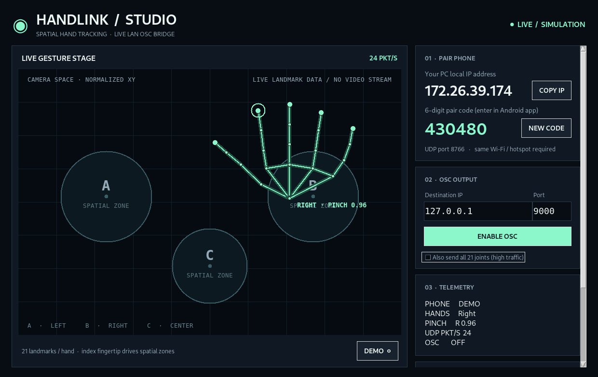

# HANDLINK / STUDIO · Wireless Hand Tracking

**Android camera → on-device hand tracking → lightweight LAN UDP → Windows gesture stage → optional OSC output**

A two-app, open-source starter project inspired by the *idea* of [Ewan Qian's HAND / SPACE / OSC lab](https://ewanqian.github.io/performable-music/spatial-playground/hand-osc-lab/). All HandLink interface and application source in this repository is newly written. HandLink is **not** a fork or official companion app.



> **Build status:** Desktop Python app and its protocol/zone tests have been exercised locally, including a headless UI smoke test. Android source and Windows EXE/Android APK GitHub build workflow are provided. **The APK and Windows EXE have not yet been built or tested on physical devices.** Do not present the project as a fully validated release until both binaries build, pairing works on a real LAN and latency is measured.

## What works / intended behavior

- **Android companion app:** CameraX front/back camera, **Google MediaPipe** on-device 21-keypoint tracking (two hands), live overlay, six-digit pairing, UDP streaming of hand coordinates and pinch strength. No full video transfer. Bundled model in APK: no inference cloud connection required.
- **PC companion app:** Pure-Python Tkinter desktop window, pairing IP/code, skeleton renderer, three normalized 2D trigger zones A/B/C, stability dwell/hysteresis, tracking-loss timeout, one-click local JSONL recording, OSC bridge with start/stop.
- **Transport:** Direct Wi-Fi LAN (or phone hotspot with PC connected) UDP port `8766`, one datagram **per hand** to stay below 1200 bytes, sender sends 1s pairing heartbeats; PC sends a tiny acknowledgement. Stale frames aren't buffered or replayed.
- **OSC:** Standard UDP OSC to `127.0.0.1:9000` by default, **disabled until explicitly enabled**. Compatible with Max/MSP, SuperCollider, TouchDesigner, or any OSC receiver (you provide OSC routing).
- **Demo:** PC `DEMO` mode shows a simulated moving hand and zone events without phone, to test UI and OSC mappings.

## Architecture

```text
ANDROID PHONE                                     WINDOWS / LINUX PC
+------------------------+                       +-----------------------------------+
| Front/back camera      |                       | HandLink Studio GUI               |
| CameraX + MediaPipe    |-- UDP port 8766 ----->| 21-joint hand skeleton + zones    |
| 21 XYZ landmarks/hand  |   same Wi-Fi          | enter/exit/lost + pinch levels    |
| Six-digit code + IP    |<-- UDP ACK ----------| ephemeral code + local IP         |
+------------------------+                       +----------------+------------------+
                                                                     |
                                                           OPTIONAL OSC UDP
                                                                     |
                                                       Max / VJ / DAW / TouchDesigner
```

**Important:** HandLink does **not** create absolute real-world 3D tracking from one phone camera. Its X/Y coordinates are image-normalized (`0–1`); its Z is MediaPipe *relative* hand depth, **not absolute meters**. Zones are 2D screen-space circles. Ewan's original *WebXR headset* lab includes 25 headset joints and 3D metric XR zones, which a monocular phone camera cannot reproduce directly.

## Quick installation (when APK/EXE builds are available)

1. This project lives at [Huzaifa23-cop/Hand-VR-](https://github.com/Huzaifa23-cop/Hand-VR-). Keep all folders intact, including `.github/workflows/build-installers.yml`.
2. GitHub **Actions** → **Build HandLink APK and Windows EXE** → **Run workflow**. On completion, open the run and download the two **Artifacts** ZIPs. They contain `app-debug.apk` and `HandLink-Studio.exe` respectively. GitHub Actions must be enabled on the repository.
3. On Windows, extract `HandLink-Studio.exe` and double-click it. If Windows prompts about a new unsigned app, review the source and proceed only if you trust the build. On Android, extract `app-debug.apk`, open it, and authorize installing from that source in Android settings (then turn it back off if desired).
4. Connect phone and PC to the **same Wi-Fi network** or use your phone hotspot. Start the desktop app: it shows a **PC IP** and a fresh **six-digit code**.
5. In the Android app, allow the camera, enter **PC IP** and **pair code**, then tap **CONNECT**. Watch for `CONNECTED · STREAMING HANDS`. Move your hand in frame: the PC stage displays live skeletons and zone triggers.
6. Optional: Start your OSC receiver on port **9000**. Click **ENABLE OSC** in the PC app. That is separate from the phone connection.

If Windows Defender Firewall asks for network access, allow HandLink on **Private networks only** (the program receives UDP on port `8766`). If it doesn't ask, add an inbound UDP firewall rule for port `8766` for private networks. Never expose the receiver to the public Internet. Check for *client isolation* if both devices are connected but do not communicate. A VPN may cause the wrong PC IP to be displayed; use the PC's active Wi-Fi IPv4 address from `ipconfig` instead. **Pairing and hand tracking happen independently:** the Android app can pair even if no hands are currently visible.

## Run desktop source without waiting for an EXE

The desktop app needs **Python 3.11+ and Tkinter**; no `pip install` is required to run it.

```sh
python desktop/main.py
```

On Windows, double-click `run-desktop.bat` if Python is installed. Press **DEMO** to test the receiver UI right away. The IP in the development screenshot is from a container, **not your PC's IP**.

## Build APK from Android Studio

Open the `android/` folder in Android Studio with JDK 17. Build → Build APK(s). The Gradle build downloads Google's official hand-landmarker model into `android/app/src/main/assets/hand_landmarker.task` if absent. That model is needed to run and will be **bundled into the APK**. Once installed, tracking works without Google servers. Requires Android 8.0+ (SDK 26+). On real hardware, run the Android app with its display on; this version intentionally does **not** run as a background camera service.

## Build Windows EXE from source

On **Windows**, with Python 3.11+ installed:

```powershell
pip install pyinstaller
pyinstaller --onefile --windowed --name HandLink-Studio desktop/main.py
```

Then open `dist/HandLink-Studio.exe`. Cross-compiling a reliable Windows EXE on Linux is not supported by standard PyInstaller. Use Windows or the included Windows GitHub Actions job.

## OSC outputs

OSC targets can be set in the PC UI. All OSC output is off until enabled. Example messages:

| OSC address | Type | Description |
| --- | --- | --- |
| `/handlink/hand/right/index-tip` | `float x, float y, float z` | normalized index fingertip; z is relative, not meters |
| `/handlink/hand/left/pinch` | `float` | 0–1 normalized pinch estimate |
| `/handlink/hand/right/tracked` | `int` | 1 = tracked, 0 = lost |
| `/handlink/zone/A/enter` | `string` | `left` or `right` hand entered |
| `/handlink/zone/B/exit` | `string` | zone exit after dwell and hysteresis |
| `/handlink/zone/C/tracking-lost` | `string` | hand was lost; **not** a fabricated exit |
| `/handlink/system/connected` | `int` | 1 paired / 0 OSC stopped |
| `/handlink/system/stale` | `int` | 1 after tracking timeout |
| `/handlink/system/soft-panic` | `int` | 1 when user stops OSC |
| `/handlink/hand/right/joint/8` | `float x,y,z` | optional full stream joint, enable in desktop app |

You can add more zones or change their centers and radii in `desktop/protocol.py`, `ZONES`, in normalized image coordinate space. Zone decisions are index-fingertip-based, with 55ms dwell, 0.015 entry and 0.025 exit margins by default.

## Test desktop

```sh
python -m pip install pytest
python -m pytest desktop/tests -q
```

The included tests validate packet parsing, wrong pairing code rejection, malformed data, UDP packet size constraints, OSC byte encoding and zone logic. The desktop UI has been launched inside a virtual display with simulated hand data; Android camera and PC/phone physical integration are **not** covered by these tests.

## Performance / security / privacy

- On-device camera inference, **no raw images sent**; no cloud or account required after APK build. Hand position payloads are sent over **unencrypted UDP** on your LAN. **Use only a trusted private Wi-Fi network.** A six-digit code prevents accidental cross-talk but is not cryptographic protection.
- Output rate depends on phone hardware and camera inference; typical target is responsive real-time interaction, **not a measured latency guarantee**. Try 5GHz Wi-Fi, a clear line of sight, and disabling battery-saver mode if performance is poor.
- This is **not a safety-critical or medical interface**, and software OSC panic is **not an independent physical audio emergency stop**. Always have a hardware volume/kill control for live shows.
- Trackers can lose a hand when occluded; tracked state expires after ~550ms and issues `tracking-lost` instead of an invented zone EXIT. Wi-Fi drop and restart behavior needs physical testing.
- Debug APKs built by GitHub Actions are signed with a debug key; **do not publish as a production store release**. A public signed release needs a properly managed keystore, signing process and tested binaries.

## Attribution

Concept reference: [Ewan Qian's HAND / SPACE / OSC Lab](https://github.com/ewanqian/performable-music/tree/main/spatial-playground/hand-osc-lab). Hand landmarks powered by Google's [MediaPipe Hand Landmarker](https://developers.google.com/edge/mediapipe/solutions/vision/hand_landmarker) and Android [CameraX](https://developer.android.com/media/camera/camerax). Please review the respective third-party SDK and model licenses before redistribution. This repository's original code is MIT-licensed; no code from the reference lab has been copied.

## Roadmap

- Validate Android APK build, Windows EXE build and real-device pairing, then publish an actual tested release.
- Add measured camera→OSC latency and jitter diagnostics with synchronized instrumentation.
- Add QR code pairing and multiple Wi-Fi adapters / discoverable PC beacons.
- Add optional calibrated perspective/relative-size 3D zones with explicit measurement uncertainty; don't claim XR metric depth.
- Offer configurable gesture mapping, MIDI, and configurable OSC paths.
